# iLynxOS 1.03 (Noble Modern Edition)
### *A Standalone, Rootless Linux Desktop Operating System for Android Smartphones*

> *"A computer shouldn't be defined by its physical shape. It should be defined by what it empowers you to do."*

<div align="center">

[-FF6B00?style=for-the-badge&logo=android&logoColor=white)](https://github.com/Smruti-Ranjan-Sahoo-Tech/iLynxOS/raw/main/iLynxOS-v1.03-NobleModern.apk)
[-4285F4?style=for-the-badge&logo=google-drive&logoColor=white)](https://drive.google.com/drive/folders/1NccoZ5Rzscwexz7wHoOnbkjgeeWpkwaf)

</div>

---

### 📥 Downloads & Quick Links

| Deliverable / Resource | Download / Access Link | Size & Notes |
| :--- | :--- | :--- |
| **📱 iLynxOS Android APK** | [**Download iLynxOS-v1.03-NobleModern.apk**](https://github.com/Smruti-Ranjan-Sahoo-Tech/iLynxOS/raw/main/iLynxOS-v1.03-NobleModern.apk) • [Local File Link](file:///media/smruti/bb847b45-9fb8-4899-b51d-779c6768f27f1/mobile-dev-os/smartphone-movile-os/iLynxOS/iLynxOS-v1.03-NobleModern.apk) | **~28 MB** • Noble Modern Edition standalone APK |
| **📦 Rootfs Archive (iLynx.tar.gz)** | [**Download iLynx.tar.gz (Google Drive)**](https://drive.google.com/drive/folders/1NccoZ5Rzscwexz7wHoOnbkjgeeWpkwaf) | **~1.4 GB** • Official Ubuntu 24.04 LTS LXQt filesystem |
| **📖 Complete Guide & Architecture** | [**start.md**](file:///media/smruti/bb847b45-9fb8-4899-b51d-779c6768f27f1/mobile-dev-os/smartphone-movile-os/iLynxOS/start.md) | Full technical, architecture & customization manual |

---

**Developer & Lead Architect:** [Smruti Ranjan Sahoo](https://github.com/Smruti-Ranjan-Sahoo-Tech)  
**Email:** [s.r.sahoo370@gmail.com](mailto:s.r.sahoo370@gmail.com)  
**GitHub Repository:** [https://github.com/Smruti-Ranjan-Sahoo-Tech/iLynxOS](https://github.com/Smruti-Ranjan-Sahoo-Tech/iLynxOS)

---

## 🌟 The Purpose & Philosophy Behind iLynxOS

> *"A computer shouldn't be defined by its physical shape. It should be defined by what it empowers you to do."*

### Why I Am Building iLynxOS
Computing power should never be confined or limited by the physical form factor of the device you happen to own or carry.

Almost everyone carries a smartphone wherever they go, but laptops are not always available, portable, or financially accessible. Meanwhile, modern smartphones are powered by extraordinary silicon—multi-core CPUs, gigabytes of fast RAM, high-speed NVMe/UFS storage, and advanced wireless networking—capable of handling far more than traditional, sandboxed mobile apps.

I believe **every smartphone should have the inherent potential to become a complete, personal computer whenever the user needs one.**

The ultimate purpose of iLynxOS is not to replace smartphones or laptops. **It is to eliminate the dependency on carrying a laptop just to access the raw power, productivity, and freedom of a real computer.**

### 🎯 Core Motivations

* **🌍 Democratizing Computing Access:** Not everyone can afford or carry a laptop. iLynxOS transforms the smartphone already in your pocket into an accessible, high-performance personal workstation.
* **⚡ Breaking Device Limitations:** Shatter the restrictions of traditional mobile operating systems and unlock a true desktop experience with full multitasking, window management, and native peripherals.
* **💻 Empowering Developers Everywhere:** Carry a genuine Linux environment on the go—complete with full terminal runtimes, compilers, package management (`apt`), Git, programming languages (Python, Rust, C++, Node.js), and desktop IDEs like VS Code.
* **🔓 Championing Software Freedom & Sovereignty:** Users deserve complete control and ownership over their computing environment rather than being confined to predefined, walled-garden mobile paradigms.
* **🖥️ Unifying the Device Ecosystem:** Effortlessly bridge smartphones, tablets, external HDMI monitors, and Smart TVs into a continuous, flexible workspace through low-latency wireless desktop sharing (VNC & HTML5 Web).
* **🎒 True Workspace Portability:** Your development stack, project files, configurations, and personal workflow travel with you everywhere—never bound to a single physical machine or desk.

---

<div align="center">
  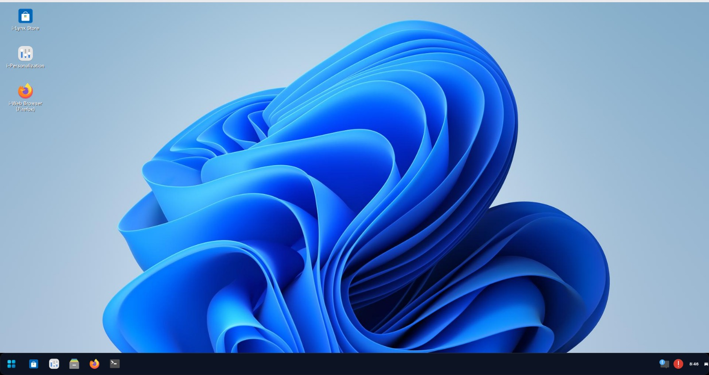
</div>

## 📸 Visual Showcase & Gallery

### 🖥️ 1. Linux Desktop Experience (LXQt Modern Desktop)

Experience a full-fledged, hardware-accelerated Linux desktop environment right on your Android smartphone display or wirelessly cast to external screens:

<table align="center" width="100%">
  <tr>
    <td align="center" width="50%" valign="top">
      <a href="images/desktop-image/image1.png">
        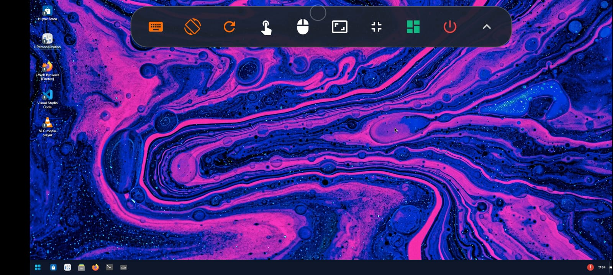
      </a>
      <br/>
      <b>Pristine LXQt Modern Workspace</b>
      <br/>
      <sub>Clean workstation layout with dark abstract styling, quick-access application dock, desktop shortcuts (VS Code, Firefox, VLC, Store), and integrated system tray.</sub>
    </td>
    <td align="center" width="50%" valign="top">
      <a href="images/desktop-image/image2.png">
        
      </a>
      <br/>
      <b>Application Launcher & Menu</b>
      <br/>
      <sub>Categorized start menu delivering instant access to installed desktop suites across Development, Internet, Graphics, Multimedia, and System Utilities.</sub>
    </td>
  </tr>
  <tr>
    <td align="center" width="50%" valign="top">
      <a href="images/desktop-image/image3.png">
        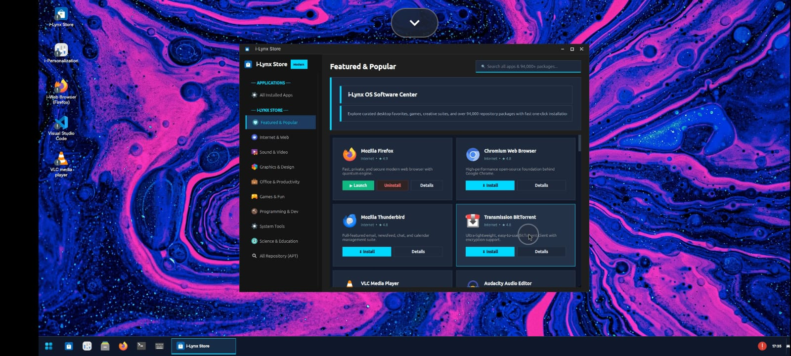
      </a>
      <br/>
      <b>i-Lynx Store (Software Center)</b>
      <br/>
      <sub>Curated graphical app store for one-click installation of desktop applications, creative suites, programming runtimes, and over 94,000 repository packages.</sub>
    </td>
    <td align="center" width="50%" valign="top">
      <a href="images/desktop-image/image4.png">
        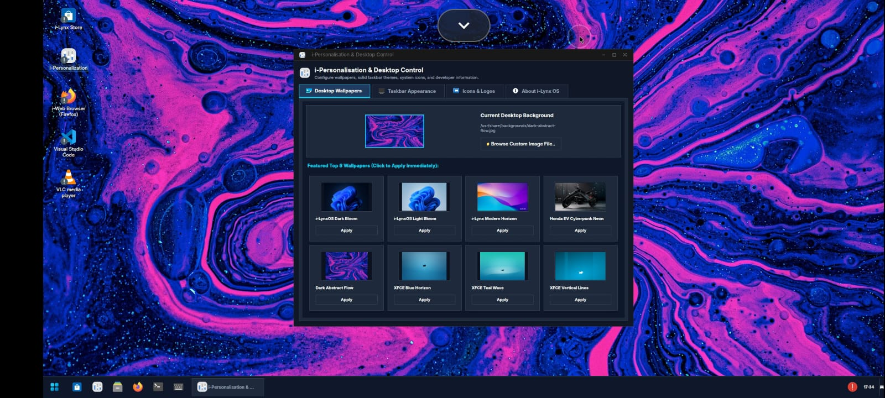
      </a>
      <br/>
      <b>i-Personalisation & Desktop Control</b>
      <br/>
      <sub>Custom control hub for managing wallpapers, taskbar appearance themes, system icon packs, and environment personalization options.</sub>
    </td>
  </tr>
</table>

---

### 📱 2. Native Android Control Center (Warm Modern Fluent UI)

The native Android host application is engineered with Jetpack Compose, featuring an adaptive edge-to-edge layout with full status bar and camera cutout inset awareness:

<table align="center" width="100%">
  <tr>
    <td align="center" width="33%" valign="top">
      <a href="images/application-ui-image/image1.png">
        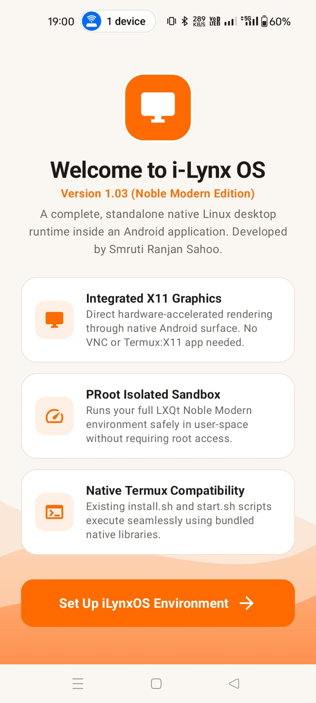
      </a>
      <br/>
      <b>1. Welcome & Overview</b>
      <br/>
      <sub>Architectural walkthrough showcasing in-process native X11 acceleration without external display servers.</sub>
    </td>
    <td align="center" width="33%" valign="top">
      <a href="images/application-ui-image/image2.png">
        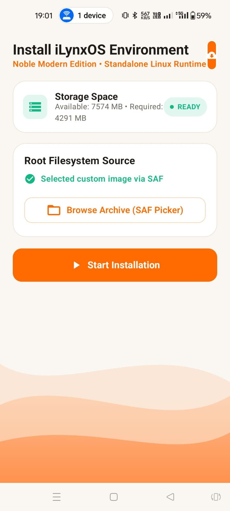
      </a>
      <br/>
      <b>2. Environment Installer</b>
      <br/>
      <sub>Automated disk space pre-check (~4.2 GB required) and Storage Access Framework (SAF) rootfs archive picker.</sub>
    </td>
    <td align="center" width="33%" valign="top">
      <a href="images/application-ui-image/image3.png">
        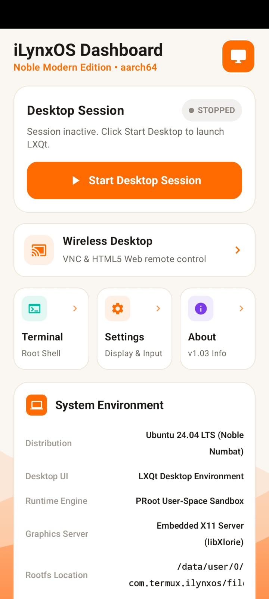
      </a>
      <br/>
      <b>3. Unified Dashboard</b>
      <br/>
      <sub>Real-time session status card, 1-tap desktop launch, wireless remote banner, and quick navigation hub.</sub>
    </td>
  </tr>
  <tr>
    <td align="center" width="33%" valign="top">
      <a href="images/application-ui-image/image4.png">
        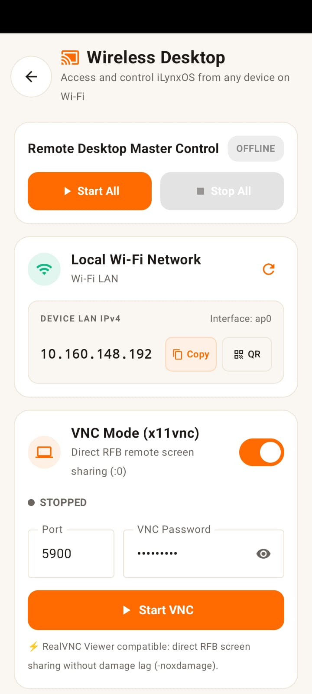
      </a>
      <br/>
      <b>4. Wireless Desktop Hub</b>
      <br/>
      <sub>Automatic local Wi-Fi interface IP discovery (`ap0`/`wlan0`), status monitoring, and master service control.</sub>
    </td>
    <td align="center" width="33%" valign="top">
      <a href="images/application-ui-image/image5.png">
        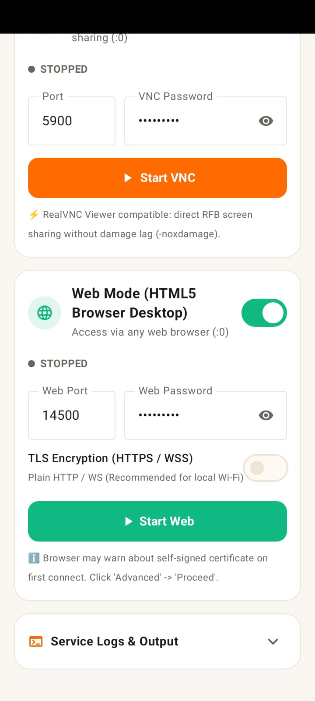
      </a>
      <br/>
      <b>5. Dual Streaming Services</b>
      <br/>
      <sub>Ultra-responsive VNC RFB mode (port 5900/5901) & HTML5 Web Mode (port 14500) supporting dedicated virtual sessions (`:1`) and screen mirroring (`:0`).</sub>
    </td>
    <td align="center" width="33%" valign="top">
      <a href="images/application-ui-image/image6.png">
        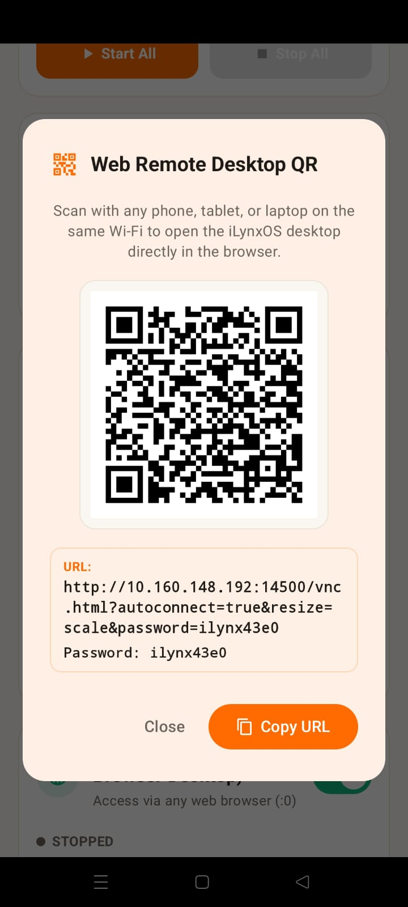
      </a>
      <br/>
      <b>6. Instant QR Browser Connect</b>
      <br/>
      <sub>Zero-software-install connection: scan QR with any PC, tablet, or phone on Wi-Fi to immediately view the desktop.</sub>
    </td>
  </tr>
</table>

The **iLynxOS Warm Modern Fluent UI** provides a unified control center for managing Linux desktop sessions, monitoring real-time system state, launching terminal environments, and broadcasting remote display streams:

- **Top Application Header**: Clean typography with dynamic notch and status bar inset padding (`Modifier.statusBarsPadding()`) that prevents camera cutout overlap.
- **Desktop Session Card**: Shows real-time session state (`RUNNING (:0)`, `STARTING`, or `STOPPED`) with direct **Open Desktop** and **Stop** action controls.
- **Wireless Desktop Banner**: One-tap access to RFB/VNC and HTML5 Web remote control streaming.
- **Quick Navigation Hub**: High-contrast squircles for fast access to the **PRoot Root Shell**, **Display & Input Settings**, and **System Information**.
- **System Environment Table**: Comprehensive live diagnostics displaying distribution release, desktop environment, virtualization engine, and embedded display server.

---

## 🌟 What is iLynxOS?

**iLynxOS** is a self-contained, native Android application that transforms consumer ARM64 smartphones into fully capable, portable Linux desktop workstations. It embeds a complete **Ubuntu 24.04 LTS (Noble Numbat)** distribution powered by the **LXQt Desktop Environment**, running alongside Android without requiring root access, unlocked bootloaders, or external dependencies.

Unlike legacy setups that rely on multiple disconnected tools, **iLynxOS packages the entire operating system stack into a single, cohesive APK (`com.termux.ilynxos`)**. Users can write code in VS Code, browse with full desktop Firefox, manage files with PCManFM, run terminal pipelines, or project their desktop wirelessly onto a monitor or browser in one tap.

---

## 🛑 The Problem Statement

Transforming a modern smartphone into a usable desktop computer has historically been plagued by severe architectural barriers:

1. **The Root Access Dilemma & Security Sandboxing**:
   - Modern Android devices enforce strict SELinux policies, read-only system partitions (`/`), and unprivileged app sandbox UIDs (`u0_a...`).
   - Traditional Linux solutions required **rooting the phone** (flashing custom kernels, unlocking bootloaders, disabling Verified Boot). This compromises device security, voids warranties, permanently trips Google Play Integrity / SafetyNet, and breaks banking and work applications.

2. **The Fragile "Multi-App Hack" (Termux + Termux:X11 + VNC)**:
   - Prior to iLynxOS, running Linux on Android required juggling 3 to 4 separate applications: a terminal emulator (Termux), an X11 display server (Termux:X11), and a third-party VNC viewer.
   - Users were forced to manually configure package repositories, fight missing glibc packages, manage UNIX socket file paths, and deal with broken bridges that collapsed whenever Android updated.

3. **Capacitive Touchscreen vs. Precision Desktop UI**:
   - Desktop environments (LXQt, XFCE, GNOME) and desktop software (VS Code, LibreOffice, GIMP) are fundamentally architected for physical mice with pixel-precise cursor targeting, right-clicks, middle-clicks, drag-and-drop, and scroll wheels.
   - Direct finger taps on a dense 1080×2400 smartphone screen are notoriously inaccurate, causing accidental clicks, misaligned window resizing, and frustrating navigation.

4. **Remote Access & Display Incompatibilities**:
   - Mobile X11 display servers do not implement the standard X11 `XDamage` extension. When users tried streaming their phone's desktop to a PC or TV via standard VNC (RealVNC, TigerVNC) or HTML5 web clients (noVNC), the connection would produce a **frozen or black screen** because the server failed to emit damage notifications.
   - Pure-Python WebSocket relays would peg the CPU at 100%, causing second-long input latency and massive frame stutter over local Wi-Fi.

5. **Android Lifecycle & "Phantom Process" Throttling**:
   - Beginning with Android 12, Google introduced the *Phantom Process Killer*, which automatically terminates background processes if an app spawns more than 32 child processes. A full desktop session naturally spawns dozens of processes (D-Bus, window managers, panel applets, notification daemons), leading to sudden, unexplained session crashes.

---

## 💡 The Solution: iLynxOS Architecture

iLynxOS solves every layer of this problem through an integrated, ground-up engineering approach:

```
┌────────────────────────────────────────────────────────────────────────┐
│                        iLynxOS Android App Host                        │
│                                                                        │
│  ┌─────────────────────────┐         ┌──────────────────────────────┐  │
│  │   Jetpack Compose UI    │         │  LorieView (SurfaceHolder)   │  │
│  │  - Dashboard & Controls │         │  - Hardware Accelerated EGL  │  │
│  │  - Floating Mouse Pad   │         │  - Native 60/90/120Hz Screen │  │
│  │  - Scrollable Topbar    │         │  - Input Matrix Mapper       │  │
│  └────────────┬────────────┘         └──────────────▲───────────────┘  │
│               │ (Starts / Monitors)                 │                  │
│  ┌────────────▼────────────┐         ┌──────────────┴───────────────┐  │
│  │   LinuxSessionService   │◄───────►│  Embedded libXlorie Server   │  │
│  │  - Foreground Service   │         │  - Native In-Process X11     │  │
│  │  - Partial WakeLock     │         │  - UNIX Socket: /tmp/.X11/X0 │  │
│  └────────────┬────────────┘         └──────────────▲───────────────┘  │
└───────────────┼─────────────────────────────────────┼──────────────────┘
                │ (User-space Virtualization)         │ (X11 Protocol :0)
┌───────────────▼─────────────────────────────────────┴──────────────────┐
│              PRoot Sandboxed Guest OS (Ubuntu 24.04 LTS)               │
│                                                                        │
│   • libproot.so + libloader.so (Syscall Interception, Fake Root 0:0)   │
│   • D-Bus Session Bus • LXQt Desktop • PCManFM-Qt • Openbox WM         │
│   • Dual Wireless Remote Daemon:                                       │
│       - Dedicated Virtual Display (:1 via Xvfb) or Mirrored Display (:0) │
│       - High-speed x11vnc RFB engine & noVNC WebSockets (Port 14500)   │
└────────────────────────────────────────────────────────────────────────┘
```

1. **Zero-Root Embedded Virtualization**:
   Bundles an integrated **PRoot** sandbox (`libproot.so` and `libloader.so`) directly inside the APK's private data storage. It intercepts system calls via `ptrace`, maps non-root user permissions to a virtual `root` (`UID 0:0`), mounts isolated guest pseudo-filesystems (`/proc`, `/sys`, `/dev`, `/dev/shm`), and executes standard Ubuntu 24.04 ARM64 binaries without modifying the host Android OS.

2. **In-Process Native X11 Display Server (`libXlorie.so`)**:
   Eliminates external X11 apps by compiling the X11 display server directly as a native C/C++ shared library embedded inside the app. It communicates over a private local UNIX domain socket (`/tmp/.X11-unix/X0`) and renders frames straight to an Android `SurfaceView` backed by hardware-accelerated EGL / OpenGL ES 2.0 at native display refresh rates.

3. **Ergonomic Native Touch & External Mouse Subsystem**:
   Introduces an intuitive, floating on-screen **X11 Mouse Pad** alongside full hardware mouse and keyboard support:
   - **Relative Trackpad Surface**: Swipe anywhere to guide the cursor with smooth mouse ballistics and customizable sensitivity.
   - **Physical Button Emulation**: Dedicated Left-Click, Right-Click, Middle-Click, and Scroll Up/Down buttons.
   - **Hardware Gestures**: 2-finger tap for context menus, 2-finger drag for vertical scrolling, and double-tap-and-hold for drag-and-drop.
   - **External Mouse Drag & Drop**: Native hardware mouse detection in Trackpad mode with stateful physical button tracking (`BUTTON_PRIMARY`, `BUTTON_SECONDARY`, `BUTTON_TERTIARY`), allowing precise drag-and-drop of files, icons, and windows without conflicting with capacitive touch gestures.
   - **Drag Lock**: One-tap toggle to hold down the left button while making complex window selections.

4. **Dual Wireless Desktop Subsystem (Workstation Anywhere)**:
   - **Dedicated Virtual Desktop Session (`:1`)**: Launches an isolated virtual workstation powered by high-performance `vncserver` (`Xvnc :1`) with Openbox and LXQt components (default 1280×720 or 1920×1080, password `raja1234`), with fallback to `Xvfb + x11vnc`. Delivers ultra-responsive 60 FPS remote responsiveness with 100% native mouse and keyboard input fidelity, completely decoupled from the smartphone screen.
   - **Mirror Phone Screen Mode (`:0`)**: Allows broadcasting the active smartphone display directly to remote monitors, PCs, and tablets.
   - **Zero-Install HTML5 Web Mode**: Integrated `websockify` + `noVNC` web server on port 14500 connecting directly to the `:1` virtual workstation backend. Connect instantly from any modern web browser on the local network by scanning the on-screen QR code—no external software installation required.
   - **One-Command CLI Controls**: Standalone launchers `vncstart` / `vncstart.sh` and `vncstop` / `vncstop.sh` accessible from root and `/usr/local/bin`.

5. **Edge-to-Edge Adaptive UI & Scrollable Fluent Toolbar**:
   Built with Jetpack Compose featuring full edge-to-edge window insets that gracefully dodge camera punch holes and system navigation bars. The in-desktop floating toolbar maintains an **identical 10-tool control suite across both portrait (vertical) and landscape (horizontal) orientations**, equipped with an inside horizontal scroll container so no controls are ever cut off.

---

## ⚙️ Engineering & Architectural Complexity

Building iLynxOS was an ambitious engineering effort that tackled problems across low-level Linux systems programming, native Android internals, and real-time graphics:

### 1. User-Space Syscall Interception (`ptrace` Overhead & glibc Mismatch)
Running a full glibc-based distribution like Ubuntu 24.04 on top of Android’s custom bionic C library requires intercepting hundreds of system calls—file access, memory management (`mmap`), process forks, permissions, and signals. iLynxOS configures PRoot's seccomp-bpf accelerators to eliminate syscall traps for safe operations while seamlessly virtualizing `/dev/shm` and SysV IPC, giving guest applications the illusion of a full Linux workstation.

### 2. In-Process Shared-Memory X11 Server Integration
Traditional Linux applications expect an X11 server running as a distinct system daemon. iLynxOS packages `libXlorie.so` inside the app’s native library folder, creates an isolated UNIX domain socket directory under the app's internal sandbox, and synchronizes the X11 event loop directly with Android's Choreographer rendering cycle.

### 3. Dedicated Virtual Displays vs. PRoot Syscall Deadlocks & XDamage Vacuum
Standard VNC servers rely on the XDamage extension to detect changed rectangles on screen. Because embedded mobile X11 servers (`libXlorie`) bypass standard X11 compositors and tie frame updates to Android's Choreographer, remote VNC clients attaching to `:0` would often see only a static image, while synthetic XTEST mouse and keyboard events were dropped. Furthermore, multi-threaded VNC servers (`-threads`) suffer severe mutex contention and latency under PRoot `ptrace` syscall interception.

iLynxOS resolves this through a dual-mode display architecture:
1. **Dedicated Virtual Session (`:1`)**: Launches an in-memory virtual X11 server via native `vncserver :1 -geometry 1280x720 -depth 24 -ac` (or `Xvfb :1` fallback) running Openbox and LXQt components with native XDamage support. This completely eliminates polling delays and ptrace thread deadlocks, delivering sub-20ms latency and 100% mouse and keyboard fidelity for remote viewers without affecting the phone display.
2. **Optimized Screen Mirroring (`:0`)**: When mirroring the smartphone screen, single-threaded `x11vnc` with calibrated socket polling delivers a fluid stream without hanging PRoot processes:
```bash
x11vnc -display :0 -rfbport 5900 -listen 0.0.0.0 -forever -shared -repeat -noshm -bg
```

### 4. Mathematical Input Mapping
Touchscreens report absolute screen coordinates `(x, y)` from top-left, whereas desktop X11 applications can run in arbitrary screen resolutions (720p, 1080p, 1600×900, or scaled custom aspect ratios). iLynxOS maintains a real-time 3×3 transformation matrix in `LorieView` that translates raw Android capacitive multi-touch `MotionEvents` into X11 core protocol events and relative trackpad deltas with sub-pixel precision.

---

## 🔄 How It Works: Step-by-Step Execution Flow

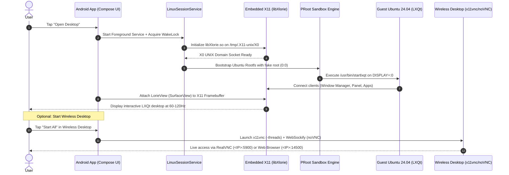

1. **User Launch**: The user taps **Open Desktop** on the dashboard.
2. **Foreground Service Binding**: `LinuxSessionService` starts with an ongoing system notification and acquires a partial `WakeLock` to prevent the Linux kernel from sleeping.
3. **Display Server Provisioning**: `libXlorie.so` initializes inside the app process, creating the UNIX domain socket `/tmp/.X11-unix/X0`.
4. **Sandboxed Bootstrapping**: `PRootRuntimeEngine` launches `libproot.so`, mounting the rootfs, binding `/dev`, `/proc`, and `/sys`, and setting up environment variables (`DISPLAY=:0`, `PULSE_SERVER=127.0.0.1:4713`).
5. **Session Execution**: D-Bus and the LXQt session manager (`startlxqt`) launch, rendering desktop widgets, panel, and pre-installed app shortcuts.
6. **Surface Presentation & Input Capture**: The Android Compose layer presents `LorieView`, compositing X11 pixmaps via OpenGL ES while routing input from direct touch, hardware keyboards, and the floating mouse pad.
7. **Remote Control (Optional)**: If Wireless Desktop is enabled, `start-vnc.sh` and `start-web.sh` launch a dedicated virtual desktop session on Display `:1` (or attach to Display `:0` in mirror mode), broadcasting the session over RFB (port 5900/5901) and WebSockets (port 14500).

---

## 🐧 OS Distribution & Customization Details (User Space)

> [!NOTE]
> *This section is reserved for custom OS configurations, installed software stacks, and personalized dotfiles.*

| Configuration Parameter | Default System Value | Custom Override Notes |
| :--- | :--- | :--- |
| **Guest Distribution** | Ubuntu 24.04 LTS (Noble Numbat) | *Add your distribution or base rootfs notes here* |
| **Desktop Environment** | LXQt 1.4+ (Openbox Window Manager) | *Customize panel, themes, or alternate WMs* |
| **System Architecture** | `aarch64` (ARM 64-bit) | *Device target architecture* |
| **Pre-Installed Tools** | `bash 5.2`, `python3`, `git`, `nano`, `curl`, `wget`, `htop` | *List additional CLI utilities you install* |
| **Default Shell & Home** | `/bin/bash` located at `/root` | *Add custom `.bashrc` or shell aliases* |
| **Desktop Launch Script** | `/usr/bin/startlxqt` | *Custom startup hooks or autostart applications* |
| **Package Manager** | `apt` (Canonical Noble Repositories) | *Custom PPAs or pinned repositories* |
| **Default Display ID** | `:0` (UNIX Domain Socket) | *In-process display target* |
| **Audio Server** | PulseAudio over TCP (`127.0.0.1:4713`) | *Audio bridge configurations* |
| **Remote VNC Port** | `5900` (RFB Protocol) | *Configured in VNC Mode settings* |
| **Remote Web Port** | `14500` (HTML5 noVNC / WebSockets) | *Configured in Web Mode settings* |

### Adding Custom Software & Boot Hooks
You can install any standard Ubuntu package inside iLynxOS via the built-in Terminal screen:
```bash
# Update Ubuntu package repositories
apt update

# Install desktop development tools
apt install -y build-essential git python3-pip openjdk-17-jdk

# Install productivity suites
apt install -y libreoffice gimp inkscape
```

---

## 📖 Complete Technical & Setup Guide

For the full technical manual—including step-by-step build instructions, Android Studio setup, phantom process tuning commands, terminal CLI reference, and license details—please refer to:

👉 **[start.md](file:///media/smruti/bb847b45-9fb8-4899-b51d-779c6768f27f1/mobile-dev-os/smartphone-movile-os/iLynxOS/start.md)**

---

## 📜 License & Acknowledgments

- **iLynxOS Launcher & Android Architecture**: © 2026 Smruti Ranjan Sahoo (Licensed under the [Apache License 2.0](https://www.apache.org/licenses/LICENSE-2.0)).
- **Embedded X11 Server**: Integrated from Termux:X11 / Lorie (GPL-3.0).
- **Virtualization Engine**: PRoot Project (GPL-2.0+).
- **Desktop Environment**: LXQt Team (LGPL-2.1+ / GPL-2.0+).
- **Rootfs Base**: Canonical Ubuntu 24.04 LTS (Noble Numbat).
