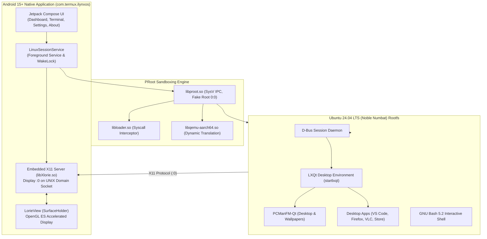

# iLynxOS 1.03 (Noble Modern Edition) - Full Technical & Setup Documentation
**Standalone Native Android OS Environment with LXQt Modern Desktop**

### 📥 Downloads & Quick Links

| Deliverable / Resource | Download / Access Link | Size & Notes |
| :--- | :--- | :--- |
| **📱 iLynxOS Android APK** | [**Download iLynxOS-v1.03-NobleModern.apk**](https://github.com/Smruti-Ranjan-Sahoo-Tech/iLynxOS/raw/main/iLynxOS-v1.03-NobleModern.apk) • [Local File Link](file:///media/smruti/bb847b45-9fb8-4899-b51d-779c6768f27f1/mobile-dev-os/smartphone-movile-os/iLynxOS/iLynxOS-v1.03-NobleModern.apk) | **~28 MB** • Noble Modern Edition standalone APK |
| **📦 Rootfs Archive (iLynx.tar.gz)** | [**Download iLynx.tar.gz (Google Drive)**](https://drive.google.com/drive/folders/1NccoZ5Rzscwexz7wHoOnbkjgeeWpkwaf) | **~1.4 GB** • Official Ubuntu 24.04 LTS LXQt filesystem |
| **🏠 GitHub Repository** | [**Smruti-Ranjan-Sahoo-Tech/iLynxOS**](https://github.com/Smruti-Ranjan-Sahoo-Tech/iLynxOS) | Source repository & releases |

---

Developer & Lead Architect: **Smruti Ranjan Sahoo**  
Email: [s.r.sahoo370@gmail.com](mailto:s.r.sahoo370@gmail.com)  
GitHub Profile: [https://github.com/Smruti-Ranjan-Sahoo-Tech](https://github.com/Smruti-Ranjan-Sahoo-Tech)  
Repository: [https://github.com/Smruti-Ranjan-Sahoo-Tech/iLynxOS](https://github.com/Smruti-Ranjan-Sahoo-Tech/iLynxOS)  

---

## 🌟 The Purpose & Philosophy Behind iLynxOS

> *"A computer shouldn't be defined by its physical shape. It should be defined by what it empowers you to do."*

### Why I Am Building iLynxOS
Computing power should not be restricted by the physical form factor of the device you happen to own or carry.

Almost everyone carries a smartphone wherever they go, but laptops are not always available, portable, or financially accessible. Meanwhile, modern smartphones are powered by extraordinary silicon—multi-core CPUs, gigabytes of fast RAM, high-speed NVMe/UFS storage, and advanced wireless networking—capable of handling far more than traditional, sandboxed mobile apps.

I believe **every smartphone should have the inherent potential to become a complete, personal computer whenever the user needs one.**

The ultimate purpose of iLynxOS is not to replace smartphones or laptops. **It is to eliminate the dependency on carrying a laptop just to access the raw power, productivity, and freedom of a real computer.**

### 🎯 Core Motivations

* **🌍 Democratizing Computing Access:** Not everyone can afford or carry a laptop. iLynxOS transforms the smartphone already in your pocket into an accessible, high-performance personal workstation.
* **⚡ Breaking Device Limitations:** Shatter the restrictions of traditional mobile operating systems and unlock a true desktop experience with full multitasking, window management, and native peripherals.
* **💻 Empowering Developers Everywhere:** Carry a genuine Linux environment on the go—complete with full terminal runtimes, compilers, package management (`apt`), Git, programming languages (Python, Rust, C++, Node.js), and desktop IDEs like VS Code.
* **🔓 Championing Software Freedom & Sovereignty:** Users deserve complete control and ownership over their computing environment rather than being confined to predefined, walled-garden mobile paradigms.
* **🖥️ Unifying the Device Ecosystem:** Effortlessly bridge smartphones, tablets, and PCs into a continuous, flexible workspace through low-latency remote VNC desktop sharing.
* **🎒 True Workspace Portability:** Your development stack, project files, configurations, and personal workflow travel with you everywhere—never bound to a single physical machine or desk.

---

## 🌟 Overview

**iLynxOS** is a standalone, native Android application built in **Kotlin** and **Jetpack Compose** that embeds a full **Ubuntu 24.04 LTS (Noble Numbat)** modern Linux distribution powered by the **LXQt Desktop Environment**.

Unlike traditional mobile Linux setups, **iLynxOS requires no external Termux app, no Termux:X11 app, and no VNC viewer**. Everything is bundled directly into a single, cohesive Android application featuring an in-process native X11 display server (`libXlorie`), an embedded PRoot user-space virtualization engine, and a hardware-accelerated OpenGL ES surface view.

<div align="center">
  
  <p><strong>Figure 1:</strong> <em>iLynxOS Dashboard on Realme Narzo 50 Pro 5G</em></p>
  <p><a href="file:///media/smruti/bb847b45-9fb8-4899-b51d-779c6768f27f1/mobile-dev-os/smartphone-movile-os/iLynxOS/assets/dashboard-preview.png">Open High-Resolution Image</a></p>
</div>

---

## 🏗️ System Architecture



---

## 🚀 Key Features

1. **Embedded In-Process X11 Server (`libXlorie`)**:
   - Zero-dependency display pipeline: `libXlorie.so` runs directly inside the Android app process.
   - Listens on UNIX domain socket `/data/user/0/com.termux.ilynxos/files/usr/tmp/.X11-unix/X0`.
   - Native hardware-accelerated surface composition via EGL / GLES 2.0 with async surface dispatching.
   - Automatic dynamic connection recovery when navigating between screens.

2. **Embedded PRoot Sandbox**:
   - Executes the pre-installed Ubuntu 24.04 aarch64 rootfs directly in user space without requiring device root.
   - Full support for `--sysvipc`, `--link2symlink`, POSIX shared memory (`/dev/shm`), and root privilege emulation (`--change-id=0:0`).
   - Seamless compatibility bridges for user-provided [install.sh](file:///media/smruti/bb847b45-9fb8-4899-b51d-779c6768f27f1/mobile-dev-os/smartphone-movile-os/iLynxOS/install.sh) and [start.sh](file:///media/smruti/bb847b45-9fb8-4899-b51d-779c6768f27f1/mobile-dev-os/smartphone-movile-os/iLynxOS/start.sh).

3. **LXQt Modern Desktop Environment**:
   - Complete desktop experience with custom wallpaper and pre-configured application shortcuts:
     - `code.desktop` (VS Code)
     - `firefox.desktop` (Firefox Browser)
     - `ilynx-store.desktop` (Software Store)
     - `vlc.desktop` (VLC Media Player)
     - `change-wallpaper.desktop` (Wallpaper Switcher)
   - Real-time touch and mouse pointer tracking.

4. **Floating Fluent Toolbar**:
   - **Keyboard Toggle**: Instantly show or hide the virtual Android on-screen keyboard (IME).
   - **Rotate Screen**: Toggle between portrait and landscape orientations with automatic surface recalibration.
   - **Refresh Display**: Force-redraws the X11 surface to eliminate any transient blank frames.
   - **X11 Mouse Pad Toggle**: Opens/closes the floating onscreen mouse pad with Left/Right/Middle buttons and scroll wheels.
   - **Mouse Mode Selector**: Toggle between *Direct Touch*, *Touchpad Mouse (Relative)*, and *Stylus Pointer*.
   - **Resolution Selector**: Choose between *Native Fit*, *1280x720 (720p HD)*, *1920x1080 (1080p FHD)*, *1024x768 (4:3)*, and *1600x900 (16:9)*.
   - **Fullscreen Toggle**: One-tap immersive mode hiding system navigation and status bars.
   - **Dashboard Return**: Switch back to the dashboard while keeping the Linux session running in the background.
   - **Session Shutdown**: Safe power-down button guarded by a confirmation dialog to prevent accidental session termination.
   - **Scrollable Container**: Responsive horizontal scroll mode guarantees all 10 controls are fully accessible on vertical and horizontal phone screens.

5. **Integrated PRoot Linux Shell**:
   - Built-in terminal emulator executing directly inside the guest rootfs.
   - Quick command chips (`cat /etc/os-release`, `uname -a`, `whoami`, `ls -la /`, `df -h`, `free -m`, `ps aux`, `which startlxqt`).
   - One-tap clipboard copy and history clearing.

6. **VNC Remote Desktop**:
   - **TigerVNC / RFB Server**: High-performance VNC server with low CPU overhead, configurable resolution, and password authentication. Compatible with TigerVNC, RealVNC Viewer, Remmina, and AVNC.
   - **Dual-Session Flexibility**: Switch between a dedicated headless virtual desktop (`:1`) or mirror the on-device mobile screen (`:0`).
   - **One-Tap Controls**: Automated lifecycle management via `vncstart` and `vncstop` directly inside the app.

7. **Foreground Service & Lifecycle**:
   - `LinuxSessionService` keeps the desktop environment alive in the background.
   - Persistent partial wake lock prevents Android doze and standby CPU throttling.
   - Ongoing system notification with status and one-tap Stop action.

---

## 📱 Deliverable APK

| Item | Details |
| :--- | :--- |
| **Filename** | [iLynxOS-v1.03-NobleModern.apk](file:///media/smruti/bb847b45-9fb8-4899-b51d-779c6768f27f1/mobile-dev-os/smartphone-movile-os/iLynxOS/iLynxOS-v1.03-NobleModern.apk) |
| **Package Name** | `com.termux.ilynxos` |
| **Target SDK** | Android 14 / 15 (API 34/35) |
| **Min SDK** | Android 8.0 (API 26) |
| **Size** | ~28 MB |
| **Supported ABIs** | `arm64-v8a`, `x86_64` |

---

## 🛠️ Building and Running

### Build Prerequisites
- JDK 17+
- Android SDK (API 34/35, Build Tools 34.0.0+)
- Android NDK (r25c or newer)

### Build Command
```bash
./gradlew assembleDebug
```

The compiled APK will be generated at:
```bash
app/build/outputs/apk/debug/app-debug.apk
```

### Install to Device / Emulator
```bash
adb install -r app/build/outputs/apk/debug/app-debug.apk
```

### Android 12+ Child Process Setting (Recommended)
On Android 12, 13, 14, and 15, Android's `ActivityManager` limits spawned child processes to 32 by default. To allow heavy multitasking in Linux desktops, run:
```bash
adb shell "/system/bin/device_config put activity_manager max_phantom_processes 2147483647"
adb shell "setprop persist.sys.fflag.override.settings_enable_monitor_phantom_procs false"
```

---

## 📄 License & Attribution

- **iLynxOS Launcher & UI**: Developed by Smruti Ranjan Sahoo (Licensed under [GNU General Public License v3.0 (GPLv3)](LICENSE)).
- **Embedded X11 Server**: Forked & integrated from Termux:X11 / Lorie (GPL-3.0).
- **PRoot Sandbox**: PRoot Project (GPL-2.0+).
- **Desktop Environment**: LXQt Team (LGPL-2.1+ / GPL-2.0+).
